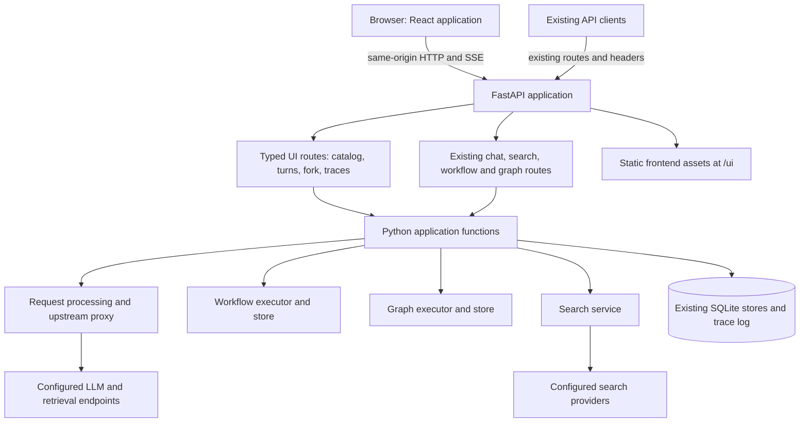

# Frontend migration architecture

Status: proposed architecture and implementation sequence, 18 October 2026.

Replace the Shiny dashboard with a TypeScript browser application. Retain FastAPI,
the Python orchestration and search code, and the existing SQLite stores. The
recommended frontend is **React with Vite**, with browser routing and a small set
of established libraries. Production serves compiled assets alongside the Python
API; Node is a development and build dependency.

The first migration task is to extract application behavior currently embedded in
Shiny. Changing the rendering framework alone would move conversation policy,
prompt construction, and transcript persistence into browser code and duplicate
backend responsibilities.

This proposal assumes an operator-facing application, a small trusted user group,
one backend process, and no requirement for public search indexing or server-side
rendering. Revisit deployment and authorization if independent user accounts or
multiple backend workers become requirements. Implementation has not started.

## Current architecture and migration drivers

The current entry point starts FastAPI on `0.0.0.0:12340` and Shiny on
`127.0.0.1:12341` in daemon threads. There is no checked-in frontend build or
deployment configuration. The dashboard contains about 6,400 lines of Python;
`app_server.py` alone contains 2,312 lines and `app_ui.py` contains 679.

The existing HTTP boundary is useful, but incomplete:

| Existing behavior | Current location | Consequence for migration |
|---|---|---|
| Routing, reasoning normalization, retrieval injection, persistent history, slot affinity | `src/orchestrator/request_processor.py`, `upstream_proxy.py`, `conversation_store.py` | Preserve as backend authority. |
| Search providers, model-assisted refinement and reranking | `src/search/`, `src/orchestrator/search_routes.py` | Preserve implementation and search API. |
| Workflow and graph registries, execution, storage, run APIs | `src/orchestrator/workflow/`, `graph/`, `runtime/`, `src/graphs/` | Preserve separate domain models and APIs. |
| Configuration reads, retrieval health probes, provider choices and display timezone | `src/dashboard/utils.py` | Expose a filtered backend catalog; browsers cannot read local YAML or probe server-local services. |
| Trace viewer reads local JSONL files | `src/dashboard/utils.py:read_trace_events` | Add a bounded backend query endpoint. |
| Cloudflare service credentials attached to dashboard HTTP calls | `src/dashboard/chat_client.py` and other clients | Keep service credentials in Python; define browser authentication independently. |
| Prompt/reasoning changes fork conversations and copy prior history | `src/dashboard/app_server.py`, `prompt_state.py` | Move the operation into a backend transaction. |
| Ad hoc search evidence and workflow dispatch prepare chat requests | `src/dashboard/app_server.py`, `search_flow.py`, `workflow_server_helpers.py` | Extract Python application functions before replacing UI handlers. |
| Workflow chat dispatch appends user and final assistant messages | `src/dashboard/app_server.py` | Backend must finalize the transcript even when the browser leaves. |
| Response diagnostics combine raw metadata, model catalog snapshots and formatting | `response_metrics.py`, `cache_telemetry.py` | Keep normalization in Python and rewrite rendering in TypeScript. |
| Up to eight independent chats, burst submission and stop controls | `src/dashboard/multi_slot.py` | Reimplement browser state and concurrency while retaining session-only histories. |

Documentation and code currently disagree on some contracts. The code uses
`X-Conversation-ID`, `X-Retrieval-Endpoint`, and `X-Retrieval-*`; existing guides
also describe `X-Convo-ID` and `X-RAG-*`. Retrieval discovery currently logs failed
health probes but still includes those endpoints, despite the dashboard guide
describing healthy-only choices. Establish fixtures from running code and tests,
then correct these descriptions during contract work.

## Framework decision

Framework suitability here depends on managing concurrent streams, rich diagnostic
views, explicit state, browser tests, and a Python API. All three mainstream
browser component frameworks can meet those requirements; there is no measured
performance advantage established by this assessment.

| Option | Fit and tradeoff | Decision |
|---|---|---|
| React + TypeScript + Vite | Explicit reducers and broad component integration choices; requires deliberate routing, query-cache and effect conventions. Static build fits the existing Python backend. | Recommended default. |
| Svelte + TypeScript, with SvelteKit static SPA output | Concise component/state code and integrated routing. Equally viable if maintainers prefer Svelte; the same backend extraction is still necessary. | Strong alternative. |
| Vue + TypeScript + Vite | Suitable SPA component model and routing ecosystem; choose it if maintainers have stronger Vue experience. | Viable alternative. |
| Next.js | Supports static export, so it does not inherently require a production Node server. Its server rendering and server-component features do not address the current requirements. | Defer unless server-rendered product pages or a deliberate JS server become requirements. |
| Further Shiny refactoring or another Python dashboard framework | Can improve module size, but retains server-driven browser interaction and the need to integrate custom browser behaviors. A lateral framework switch would also rewrite UI code. | Keep Shiny for transition; replace it at cutover. |

These are engineering judgments for this repository. React documents both the
[Vite SPA approach and its routing/data-fetching tradeoffs](https://react.dev/learn/build-a-react-app-from-scratch).
The alternatives support [SvelteKit SPAs](https://svelte.dev/docs/kit/single-page-apps),
[Vue SPAs](https://vuejs.org/guide/extras/ways-of-using-vue.html), and
[Next.js static export](https://nextjs.org/docs/app/guides/static-exports).

Use this initial frontend stack:

| Concern | Choice |
|---|---|
| Components and types | React, TypeScript with strict checking. |
| Build and local development | Vite; one `frontend/package.json` and npm lockfile. Pin a supported Node LTS when scaffolding. |
| Navigation | React Router in [declarative mode](https://reactrouter.com/start/modes), based at `/ui`; route-level lazy loading. |
| Server snapshots and catalogs | TanStack Query. Disable focus/reconnect refetch for model discovery and disable automatic retries for commands. Streams have their own lifecycle. |
| Local state | Feature reducers and small context providers; add a global state library only if measured complexity warrants it. |
| Components and styling | Semantic HTML, CSS variables and CSS modules; accessible library primitives only where needed for dialogs, menus or tabs. |
| Model output | `react-markdown` with GFM support, raw HTML disabled; separate reasoning, evidence, error and metrics components. |
| API types | [openapi-typescript](https://openapi-ts.dev/introduction) for documented HTTP contracts; explicit schemas/fixtures for stream frames and dynamic workflow/graph payloads. |
| Streaming | `fetch`, `AbortController`, and an established SSE parser such as [eventsource-parser](https://github.com/rexxars/eventsource-parser). |
| Verification | Vitest and Testing Library for behavior; Playwright for browser flows against deterministic backend fixtures. |

Model discovery has side effects on the router's reachable-endpoint cache. Treat
refresh as deliberate rather than a consequence of tab focus. TanStack Query
[supports disabling focus refetch](https://tanstack.com/query/latest/docs/framework/react/guides/window-focus-refetching).
Do not adopt a chat SDK that replaces the existing completion/event protocol
unless it preserves the tested reasoning, usage, routing and error semantics.

## Target boundaries and deployment



Keep one Python backend and one frontend project in this repository. UI routes are
thin adapters over Python functions in the existing process. They do not call the
proxy over HTTP or import Shiny. Workflow and graph execution stay independent;
shared transport and metric components do not imply a shared executor.

In production, serve `frontend/dist` under `/ui/`. Register UI APIs, existing APIs,
and the static mount before the current `/{path:path}` proxy fallback. Restrict
SPA fallback to known UI navigation requests: missing assets return 404 and API
errors never return the frontend HTML. Reserve `/ui` and `/api/ui/v1` explicitly
and check configured endpoint names for conflicts. Vite supports a
[static production build with a configured base path](https://vite.dev/guide/build).

During development, run FastAPI, legacy Shiny, and Vite separately. Vite proxies
the explicitly used API paths to FastAPI; its browser URLs remain same-origin.
Do not proxy the entire root path, which belongs to Vite's application server.
At cutover, the normal Python entry point starts the backend with compiled assets.
Keep an explicit legacy launch option until rollback is retired. Production starts
from an existing asset build and never installs npm packages at startup.

The existing bind addresses matter: placing the UI on port 12340 would expand its
reach beyond the current localhost-only dashboard. UI-enabled local deployments
must bind to loopback by default; remote operator access must put the complete UI
and its APIs behind the existing authenticated ingress. Keep the legacy API-only
binding available explicitly. Do not enable the new UI on the old all-interface
listener silently. Verify the actual Cloudflare/tunnel routing before cutover.

Browser requests use the operator's same-origin session where ingress provides
one. `API_KEY_ID` and `API_KEY_SECRET` remain server-side upstream credentials;
they are not a browser login mechanism. Never place them in Vite environment
variables, bootstrap payloads, logs returned to the browser, or generated assets.
Validate origins for UI mutations and retain JSON content-type requirements.
Independent account ownership and per-user authorization are a separate product
requirement; the current conversation IDs do not provide that isolation.

Keep `uv`, `.venv`, `pyproject.toml`, and `uv.lock` for Python. Keep npm dependencies
and their lockfile inside `frontend/`. Package the compiled assets with the release
artifact and verify startup from outside the repository working directory.

## What to keep, refactor, migrate and remove

| Area | Action | Intended result |
|---|---|---|
| `src/search/`, search safety markers and normalization | Keep | Existing provider behavior, ephemeral evidence semantics and explicit reranking. |
| Routing, retrieval, reasoning and upstream proxying | Keep; add narrow callable seams where necessary | Shared request behavior for existing clients and UI routes. Avoid a second implementation in TypeScript. |
| `conversation_store.py`, workflow/graph stores and existing data | Keep; add only required transactional operations | Existing IDs, histories, runs and artifacts remain usable. No database replacement. |
| Workflow YAML, graph Python/YAML, `langgraph.json` | Keep | Execution definitions remain backend-owned and independently enabled. |
| `src/llm_metrics.py`, logging and trace collection | Keep | Existing per-call instrumentation remains authoritative. |
| `prompt_state.py`, search request shaping and workflow dispatch helpers | Refactor into backend application functions | Python owns fork policy, evidence construction, thread briefing, param merging and durable transcript writes. |
| Pure metric/cache normalization inside dashboard modules | Extract into a UI-independent Python module | Both Shiny and the browser consume the same normalized values during transition. |
| `proxy.py` composition | Refactor narrowly | One app factory registers every route and lifecycle hook. Currently `create_app()` and the module-level app have different route coverage. |
| `utils.py` config/health/file access | Move behind backend APIs | No browser access to config files, arbitrary paths or server-local URLs. |
| `app_ui.py`, Shiny reactive state, chat rendering, formatters | Rewrite in TypeScript components | Browser owns layout, local drafts, view state and rendering. |
| `multi_slot.py` pane state and task controls | Rewrite in TypeScript | Independent request controllers and reducers for up to eight panes. |
| `chat_client.py`, `workflow_client.py`, `graph_client.py` | Replace with typed browser clients | Preserve protocol fixtures and response semantics rather than translating callbacks line by line. |
| Shiny JavaScript DOM handlers, websocket heartbeat/diagnostics, theme plumbing | Remove after cutover | Normal browser events, fetch/SSE lifecycle, CSS theme tokens and request diagnostics. |
| Shiny startup thread and `shiny`, `shinychat`, `shinyswatch` dependencies | Remove after parity and rollback gates | One production backend process and static frontend assets. |

Do not introduce a Node API, microservices, GraphQL, Redis, an external task queue,
or a generic workflow/graph abstraction for this migration. Continue using one
backend worker while execution ownership and locks are process-local.

Suggested file boundaries, created only as their feature is implemented:

```text
frontend/
  src/
    app/                 # routes, application shell, providers, theme
    api/                 # generated types, HTTP client, SSE decoding
    features/
      chat/              # durable chat and turn rendering
      multi-slot/        # ephemeral panes and burst controls
      workflows/         # catalog, params, steps and artifacts
      graphs/            # graph inputs, events and resume controls
      history/           # conversation list and transcript
      traces/            # bounded filtered diagnostics
    components/          # shared metrics, reasoning, evidence, JSON viewer
  tests/                 # browser scenarios and protocol fixtures
src/orchestrator/
  ui_api.py              # additive UI routes and contract models
  chat_turns.py          # extracted single-slot turn preparation/dispatch
  conversation_actions.py # transactional fork operation
  catalog.py             # filtered configuration, health and defaults
src/response_metrics.py   # extracted normalization, no UI imports
```

Keep domain-specific workflow transcript handling beside the workflow code.
Avoid a general frontend plugin registry or a universal page controller.

## API contracts and application behavior

Retain existing chat/search/workflow/graph endpoints for external clients. Add
`/api/ui/v1` only for behavior missing from the existing browser-safe boundary.
The following names and payload outlines are proposed contracts.

| Route | Responsibility |
|---|---|
| `GET /api/ui/v1/bootstrap` | Enabled capabilities, cached model catalog, provider/retrieval/repository choices, defaults, display timezone and UI contract version. No raw config or credentials. |
| `POST /api/ui/v1/catalog/refresh` | Refresh a validated resource selection such as models or retrieval; return catalog values, health status and observation timestamps. Retrieval failures remain visible as status rather than silently rewriting configured choices. |
| `POST /api/ui/v1/chat` | Typed non-streaming direct-chat turn; backend prepares prompt/search/retrieval controls and returns structured text, evidence and diagnostics. |
| `POST /api/ui/v1/chat/stream` | Same command with incremental UI events; reuse existing proxy execution and reasoning handling. |
| `POST /api/ui/v1/conversations/{id}/fork` | Copy durable transcript, apply a new system prompt/reasoning choice, return a new ID and explicit fork reasons. |
| `POST /api/ui/v1/workflow-dispatch` | Create and start a workflow-backed chat turn using the selected controls; return the run ID. Python owns the user/final-answer transcript writes. |
| `GET /api/ui/v1/traces` | Filter by conversation, trace ID and endpoint; enforce a bounded limit and return diagnostic fields. Never accept a filesystem path or expose raw prompt/credential fields. |

Reuse `/models`, `/conversations`, `/conversations/retrieve`,
`/conversations/state`, `/repo-context/repos`, `/workflows`, `/workflow-runs`,
`/graphs`, `/graph-runs`, and their existing actions where they already fit.
Return feature availability explicitly when orchestration subsystems are disabled.
Do not build a second CRUD facade for these resources.

Use typed request/response models at HTTP boundaries without replacing existing
dataclasses or YAML validation. Many current routes accept `Request` and return
untyped dictionaries, so generating TypeScript from today's OpenAPI document alone
would not provide a reliable contract. Type the routes needed by each migration
slice and test schemas against actual responses. OpenAPI also needs explicit SSE
event documentation and fixtures; ordinary JSON response schemas are insufficient.

Direct-chat commands distinguish durable and ephemeral modes. Durable mode sends
only the new turn and a conversation ID; Python loads history. Ephemeral mode
sends completed pane history and omits a conversation ID and explicit slot ID.
The browser submits logical configured endpoint/retrieval identifiers; Python
resolves them to URLs and checks current availability. Keep existing external API
header support while the new UI uses typed body fields.

Backend extraction must preserve these policies:

1. Changing the system prompt or reasoning after a conversation starts creates a
   fork with copied durable history and an explicit notice. An endpoint switch
   follows the existing explicit switch policy. Resolve a fork atomically and
   reject a stale source revision rather than copying half of an active turn.
   Return a conversation revision with state reads and require it for forks.
2. Ad hoc search requests five candidates with inline reranking disabled. Preserve
   query-refiner context, non-blocking search failure, and turn-local evidence
   excluded from durable history. The browser renders structured candidates; it
   does not construct the hidden evidence marker or grounding prompt.
3. Retrieval rewrites the current user turn in Python. Managed citation-suffix
   behavior, if retained, is applied exactly once by backend turn preparation.
4. Workflow dispatch maps controls from the selected spec, ignores disabled
   controls, validates required provider/retrieval/repository choices, and keeps
   uploaded source separate from the submitted request. Preserve visibility of
   intermediate/final/hidden steps and existing output-contract failures.
5. Workflow-backed chat commits its public final answer once from backend
   finalization. Reopening a run or reattaching a viewer cannot append it again.
6. Serialize mutations of the same durable conversation and the same run in the
   current process; unrelated ephemeral panes remain concurrent. A busy conflict
   returns 409 with a useful error. Coordinate run, advance, retry, resume and
   clear actions through the same per-resource guard, including existing API
   entry points. A conversation guard lasts through producer finalization even
   after a browser disconnect. Reject bulk clearing while affected runs are active.

Keep the existing databases and tables. Add a small publication ledger in the
conversation database, uniquely keyed by workflow run ID, conversation ID and
message role, so a transcript append and its receipt commit in one transaction.
Persist the run-to-conversation association before execution; reconcile a
completed run missing its publication after restart. The workflow database can be
configured separately, so do not assume a transaction can span both stores.
Derive a fork revision from durable conversation state under its write lock.
These are narrow additions; no history backfill or general event store is needed.

Include a client-generated request ID for correlation and duplicate detection
while an operation is active. This does not promise durable idempotency across a
process restart. Disable automatic command retries and reconcile history/run
state after an uncertain response. Durable request receipts can be added later if
safe automatic retries become a requirement.

## Streaming, cancellation and recovery

Use streaming `fetch` for POST requests and a proper SSE parser. Native
[`EventSource` exposes a URL and credential option](https://developer.mozilla.org/en-US/docs/Web/API/EventSource/EventSource),
which does not express these JSON POST commands. Handle split UTF-8 characters,
partial frames, multiple frames per read, CRLF, comments/heartbeats, terminal
markers and errors after the HTTP response has started.

Keep existing OpenAI SSE and workflow/graph event formats intact for external
clients. The new chat route can adapt them into a documented discriminated event
union: `turn_started`, `search_results`, `reasoning_delta`, `content_delta`,
`metrics`, `turn_completed`, and `error`. A started event carries the effective
conversation ID and fork notice. When raw JSON inspection is requested, include
the original normalized completion payload or `raw_frame` events so unknown
upstream fields remain inspectable. Stream events contain raw structured values;
rendering tags and footer Markdown never enter model history.

Share byte decoding and framing across features. Chat, workflows and graphs each
have their own typed event reducer. Do not force their state machines into one
universal run model. Errors before stream creation use a typed JSON error; errors
afterward use a terminal stream event. Unexpected EOF yields an interrupted state,
not a successful completion. Never retry a generation because parsing failed.

The chat producer already survives downstream disconnect and finalizes history.
Preserve that ownership when introducing a UI adapter: closing the adapter's
subscription must reach the proxy consumer cleanup without cancelling the
producer or leaving an accumulating subscriber queue.
The existing proxy queue is unbounded; include it in the bounded-subscriber work
and test slow readers as well as fully disconnected readers.

Workflow/graph streams currently drive execution directly from their response
generators. Before migrating those execution views, separate execution ownership
from observation using tracked tasks in the existing Python process. Keep a
bounded live-event subscription per viewer; snapshots and existing persisted
artifacts/events remain authoritative. Reuse current command routes and add
passive per-domain observation routes only where needed. Attaching a viewer must
never start a second execution. A slow viewer can be disconnected and told to
reload the snapshot; it must not block model execution or grow memory indefinitely.

This task ownership is process-local, not crash recovery. On restart, reconcile
stale running records using existing failed/error fields with an explicit
interruption reason; the UI can label that outcome Interrupted without adding a
new persisted status. Preserve graph resume only where graph checkpoint behavior
supports it. Do not promise replay of token deltas, cursor-based reconnection, or
automatic resumption without corresponding persistence support.

Distinguish **Stop receiving** from an acknowledged backend cancellation. Existing
chat inference may continue after the browser aborts. Preserve that behavior and
show it clearly. Add a true cancellation API only if upstream cancellation and
history finalization can be implemented consistently. A workflow or graph without
that support offers detaching from the live view, with execution status obtained
from a snapshot. Reconnection fetches state; it never repeats an execution POST.

Use SSE comment heartbeats while a stream is idle and verify that ingress does
not buffer them. Replace the Shiny websocket heartbeat with request/stream
diagnostics and trace IDs; the two mechanisms protect different connections.

## Browser state, navigation and diagnostics

| State | Owner and lifetime |
|---|---|
| Durable messages, route/reasoning pin, workflow/graph status and artifacts | Backend and existing stores. Reload from snapshots. |
| Endpoint/provider/retrieval catalogs and run lists | Query cache; refresh/invalidate deliberately. |
| Current streaming text, reasoning, immutable request settings and response metadata | Feature reducer, keyed by request ID; one abort controller per request. |
| Multi-slot transcripts and drafts | Browser memory for the current application session. Hidden panes retain state; reset/endpoint changes clear it. |
| Theme, metrics visibility and other harmless preferences | Local storage. Avoid persisting prompts, attachments, service tokens or session transcripts there. |
| Selected conversation/run, trace filters and active page | URL path/search parameters where useful for reload and links. |

Use `/ui/chat`, `/ui/multi-slot`, `/ui/workflows/:runId?`,
`/ui/graphs/:runId?`, `/ui/history/:conversationId?`, and `/ui/traces`.
The shell supplies navigation and catalog status. Each feature owns its controls;
generation settings and diagnostics use shared components. Preserve reasoning,
raw JSON inspection, file augmentation, themes and logout. Keep forms usable by
keyboard and expose busy, failed and interrupted states accessibly.

Multi-slot requests snapshot settings at submission, skip busy panes during a
burst, preserve individual drafts, and exclude failed/cancelled replies from the
next request history. Preserve the eight-pane limit, hidden-pane histories and
disabled destructive controls while panes are active. Pane number remains a UI
identity, not a physical inference slot. Route changes must not unmount an active
request accidentally: keep active pane/stream state above route views for the
application session; a full browser reload ends ephemeral session state.

Read existing UTF-8 source uploads in the browser; submit text, filename and size
metadata to the turn/run command. Enforce encoding, aggregate byte and request
limits on both sides; never trust a supplied local path. Preserve current
augmentation semantics before considering binary document ingestion or durable
attachment storage.

Extract metric/cache normalization from the dashboard into Python and reuse its
current tests. Expose normalized numbers with explicit units and nullable missing
values. Frontend formatting must preserve zero, distinguish missing from zero,
avoid division by zero, and never infer unreported tokens or throughput. Freeze
the model catalog/configuration associated with each response; refreshing models
must not rewrite historical footers. Keep per-call token/rate/TTFT values distinct
from workflow total elapsed time. Browser-observed timing uses a monotonic browser
clock and is labeled separately from backend-observed timing; compare durations,
never subtract timestamps from different clocks. Store wall timestamps in UTC
and apply the configured display timezone at rendering.

History reload currently cannot reconstruct every chat metrics footer because
durable messages exclude telemetry. Preserve session footers and show unavailable
diagnostics honestly after reload. A persisted per-turn diagnostics table is an
optional later feature, not a prerequisite for this migration.

## Delivery sequence and acceptance gates

Ship each slice as a reviewable change. Keep the old UI callable until the final
gate. Estimates are rough engineer-days for one maintainer familiar with the
repository, including implementation and tests; validate them after the first
working stream. They are sequencing guidance, not a delivery commitment.

| Phase | Scope | Exit condition | Effort |
|---|---|---|---|
| 0. Capture current behavior | Record sanitized representative chat SSE/JSON, search, workflow/graph snapshots and error fixtures; inventory existing dashboard regression cases and actual ingress behavior. Correct header/health contract discrepancies. | Written parity checklist, deterministic fixtures, selected frontend stack. | 1–2 days |
| 1. Complete backend boundary | Consolidate app composition; extract catalog, metric normalization, prompt/search preparation and fork operation; type the APIs needed for chat. Keep Shiny using extracted functions. | Existing behavior passes Python tests; new routes work without importing Shiny; catalog and responses contain no service secrets. | 3–5 days |
| 2. Prove one complete browser flow | Scaffold frontend, shell, typed client, streaming decoder and `/ui` serving; implement durable direct chat with reasoning, errors, metrics, forks and history reload. | Browser sends two turns, changes controls to fork, renders streamed and JSON replies, then reloads history. Legacy clients still work. | 3–5 days |
| 3. Chat parity | Add ad hoc search, retrieval controls, uploads, raw JSON and multi-slot/burst behavior. | Search evidence remains ephemeral; eight concurrent panes remain isolated; stop/failure/settings behavior matches the checklist. | 3–5 days |
| 4. Execution views | Extract workflow dispatch/transcript finalization; introduce tracked workflow/graph task ownership and observation; migrate run creation, advance/run, retry, artifacts and supported graph resume. | Leaving/reopening a view neither repeats execution nor loses the durable final transcript; workflows and graphs retain separate APIs. | 5–8 days |
| 5. Operational parity and cutover | Finish traces, timezone/theme/logout behavior, ingress smoke checks, asset packaging, docs and entry point; switch the default UI. | Full parity checklist passes behind the real ingress; rollback path exercised; no Shiny-only product feature remains. | 2–4 days |
| 6. Remove legacy | Delete unused dashboard code and Shiny dependencies, refresh `uv.lock`, remove obsolete tests and launch option after an agreed validation window. | Production starts with compiled assets and Python only; retained regression tests cover moved policies. | 1–2 days |

Expected total: approximately **18–31 engineer-days**. The largest uncertainty is
execution disconnect/finalization behavior, followed by undocumented deployment
assumptions. Do not replace the full UI before proving phase 2; that slice tests
the architecture with a useful end-to-end feature.

## Validation and rollback

Preserve existing Python backend tests. Move dashboard policy/normalization tests
with the extracted code and port browser-specific behavior tests; delete obsolete
Shiny plumbing tests only when their feature is replaced. Use fixtures as reference
comparisons so Python and TypeScript do not drift on response semantics.

Required regression scenarios:

- Durable chat sends new turns only; full-history replay remains rejected. Prompt
  and reasoning changes fork; endpoint changes retain the explicit switch policy.
- Search refinement/degradation and retrieval results preserve prompt/history
  boundaries. Workflow output visibility and final transcript persistence survive
  disconnect. Disabled subsystems render as unavailable capabilities.
- Streams handle chunk boundaries, split Unicode, usage-only frames, reasoning,
  proxy errors, abrupt EOF and abort. A second viewer cannot execute a run again.
- Eight panes maintain independent histories and settings snapshots. Bursts skip
  busy panes; failed/cancelled output is excluded; zero temperature is submitted
  and blank generation controls preserve upstream defaults.
- Missing/zero metrics, rate denominators, cache telemetry and per-call workflow
  metrics agree with current reference cases. Model refresh leaves earlier
  diagnostics unchanged; timezone formatting does not alter stored timestamps.
- Packaged UI deep links load; missing assets and unknown APIs return correct
  errors; endpoint names cannot collide with UI routes. Credentials are absent
  from browser bundles and responses. Real-ingress streams flush and remain live.
- Reload/reconnect reads state without automatic mutation replay; a backend
  restart reports interrupted work truthfully rather than leaving permanent busy
  indicators. Concurrent fork/run/retry/clear conflicts are deterministic.

Run Python checks with `uv run --locked pytest`. Once the frontend exists, its
checks are `npm ci`, type checking, unit tests, production build, and deterministic
browser tests. Live model/provider/ingress smoke tests supplement these checks;
they should not be the sole correctness evidence. Establish a measured baseline
for eight-pane rendering and stream delivery before setting performance budgets.

Additive APIs and optional transactional/schema additions must remain readable by
the legacy UI throughout coexistence. Keep the previous asset build and launcher
configuration for rollback; leave existing IDs/data in place. Do not roll back to
older backend code after new persisted statuses/schema changes without verifying
compatibility. Exercise rollback before removing Shiny, then remove only code
proven unused and update the architecture, API, dashboard and setup guides.

Decisions to verify during phase 0 are maintainer framework familiarity, the actual
remote access boundary, acceptable behavior after closing a run view, and whether
session-only multi-slot history remains sufficient. The recommendation proceeds
with the assumptions above; none requires a backend language rewrite.
